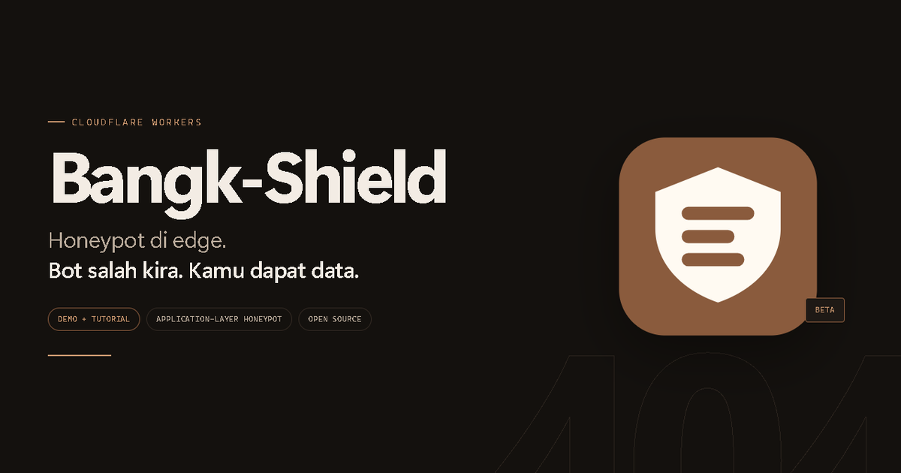
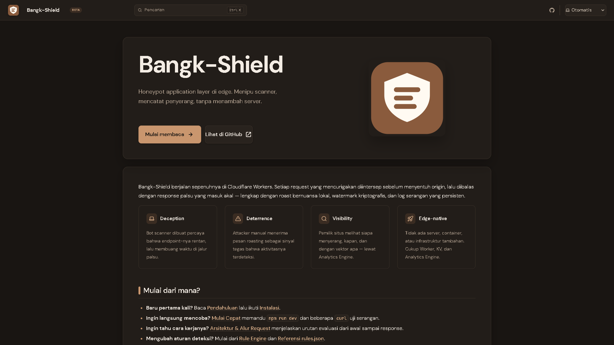
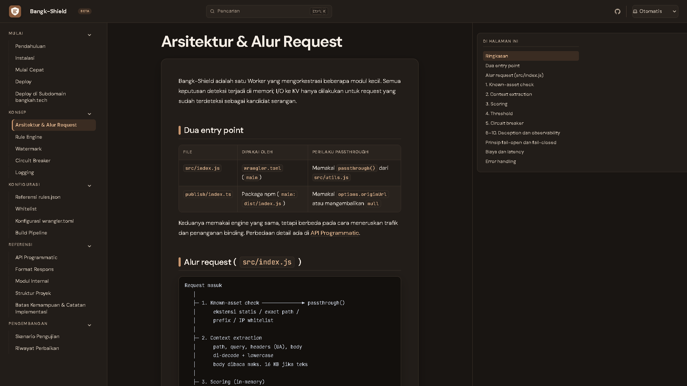
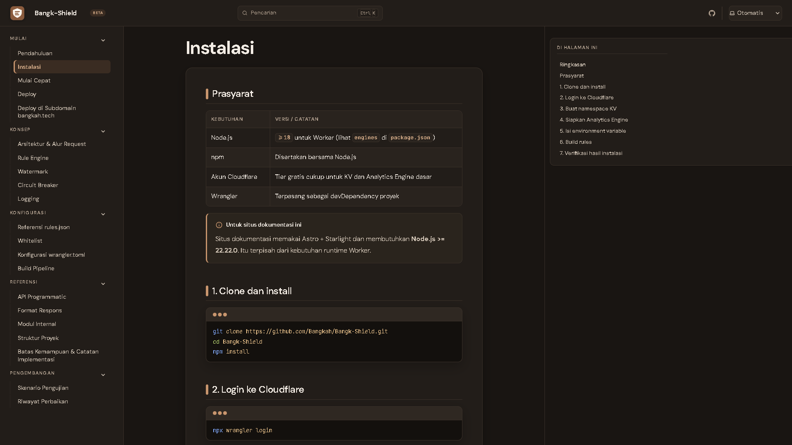
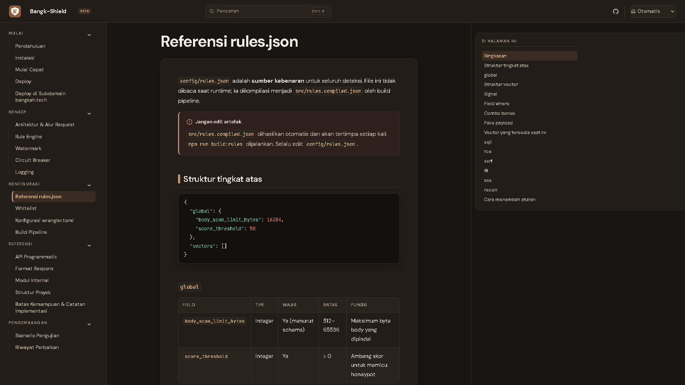
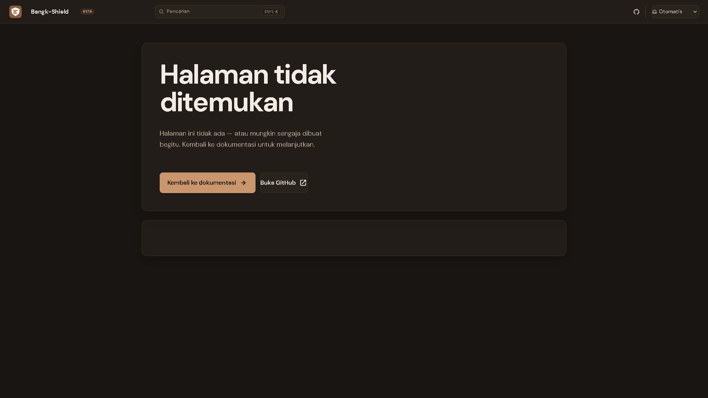

# Bangk-Shield

**Honeypot application layer di edge Cloudflare Workers.** Bangk-Shield mengintersep request mencurigakan (SQLi, RCE, SSRF, LFI, XSS, recon), membalas dengan roast lokal dan fake payload yang meyakinkan, lalu mencatat aktivitas serangan secara persisten.



[](https://github.com/Bangkah/Bangk-Shield/actions/workflows/ci.yml)
[](./LICENSE)
[](https://workers.cloudflare.com/)
[](#status-beta)

[](https://deploy.workers.cloudflare.com/?url=https://github.com/Bangkah/Bangk-Shield)

> Dokumentasi lengkap: **https://bangk-shield.bangkah.tech** - sumbernya ada di [`docs/`](./docs).
>
> Hub semua project: **https://bangkah.tech**

## Daftar Isi

- [Status Beta](#status-beta)
- [Kenapa Bangk-Shield?](#kenapa-bangk-shield)
- [Cara Kerja](#cara-kerja)
- [Mulai Cepat](#mulai-cepat)
- [Konfigurasi](#konfigurasi)
- [Watermark dan Rotasi Salt](#watermark-dan-rotasi-salt)
- [Circuit Breaker dan Logging](#circuit-breaker-dan-logging)
- [Perilaku yang Diharapkan](#perilaku-yang-diharapkan)
- [Struktur Proyek](#struktur-proyek)
- [Batasan dan Risiko](#batasan-dan-risiko)
- [Catatan Beta](#catatan-beta)
- [Roadmap](#roadmap)
- [Lisensi](#lisensi)

## Status Beta

Beta ini adalah **rewrite arsitektur**, bukan iterasi tambahan. Rule engine dipindah ke build pipeline terkompilasi, ditambah circuit breaker, watermark kriptografis, dan logging dengan sampling. Versi ini menggantikan versi sebelumnya sepenuhnya.

Bangk-Shield berjalan sepenuhnya di Cloudflare Workers. Tidak ada server, container, atau infrastruktur tambahan: cukup Worker, KV, dan Analytics Engine.



*Dokumentasi publik Bangk-Shield, sekaligus origin yang dipakai untuk demo.*

## Kenapa Bangk-Shield?

- **Deception** - bot dan scanner dibuat percaya bahwa endpoint-nya rentan, lalu membuang waktu di jalur palsu.
- **Deterrence** - attacker manual menerima pesan yang tegas bahwa aktivitasnya terdeteksi.
- **Visibility** - pemilik situs melihat siapa yang menyerang, kapan, dan dengan vektor apa lewat Analytics Engine.
- **Edge-native** - tidak perlu menambah server atau mengubah kode aplikasi.
- **Fail-open** - kalau engine error, trafik legit tetap diteruskan, bukan diblokir.

## Cara Kerja

Alur tiap request masuk (`src/index.js`):

1. **Known-asset check** (`isKnownAsset` di `utils.js`) - ekstensi statis, path/prefix di `whitelist.json`, atau IP terdaftar langsung `passthrough()`.
2. **Context extraction** - `path`, `query`, `headers` (User-Agent), dan `body` (kalau `Content-Type` berbasis teks) dikumpulkan, masing-masing di-decode (`safeDecode`) dan di-lowercase.
3. **Scoring** (`scanner.js`) - tiap vector di `rules.compiled.json` dicek sinyalnya terhadap field context yang relevan (`where`), skor dijumlahkan, ditambah combo bonus kalau kombinasi sinyal tertentu muncul bersamaan.
4. **Threshold check** - request dengan skor di bawah `global.score_threshold` (default `50`) langsung diteruskan ke origin.
5. **Circuit breaker** (`ratelimit.js`) - hanya untuk kandidat serangan. IP yang sudah memicu honeypot >=5 kali dalam 60 detik terakhir mendapat respons `403` statis murah, tanpa komputasi payload/watermark/delay.
6. **Deception** - delay acak, watermark SHA-256 dari `IP + User-Agent + tanggal + salt`, strike dicatat ke KV, event dicatat ke Analytics Engine, lalu respons berisi roast acak + fake payload JSON + header `X-Bangk-Shield` dan `X-Bangk-Shield-Watermark`.
7. **Passthrough / fail-open** - request normal diteruskan ke origin. Error di titik mana pun dicatat sebagai `engine_error`, lalu trafik tetap dicoba diteruskan.



*Alur request: known-asset check, context extraction, scoring, threshold, circuit breaker, deception, observability.*

## Mulai Cepat

### Prasyarat

- Node.js LTS terbaru dan npm.
- Akun Cloudflare (tier gratis cukup untuk KV + Analytics Engine dasar).

### Install dan jalankan lokal

```bash
npm install
npx wrangler login
npm run kv:create
```

Salin `id` dari output `kv:create` ke `wrangler.toml`, bagian `[[kv_namespaces]]`. Setelah itu:

```bash
npm run dev
```

`predev` otomatis menjalankan `build:rules` lebih dulu. Contoh pengujian:

```bash
# LFI di path -> harus kena honeypot (skor 50 = threshold)
curl -i "http://localhost:8787/etc/passwd"

# Recon sendirian -> harus LOLOS (skor 25 < threshold 50)
curl -i "http://localhost:8787/.env"

# Recon combo -> harus kena honeypot (skor 25 + 20 + 20 combo bonus)
curl -i "http://localhost:8787/.env/wp-admin"

# SQLi di query, URL-encoded -> harus kena honeypot (di-decode otomatis)
curl -i "http://localhost:8787/search?id=1%27%20union%20select%201--"

# Trafik biasa -> harus lolos normal
curl -i "http://localhost:8787/"
```



*Panduan instalasi langkah demi langkah tersedia di dokumentasi.*

### Deploy

```bash
npm run deploy
```

`predeploy` otomatis menjalankan `build:rules` lebih dulu. Isi `ORIGIN_URL` di `wrangler.toml` sebelum deploy produksi, atau `passthrough()` hanya akan membalas placeholder (lihat catatan di `src/utils.js`).

### Menjalankan situs dokumentasi

Situs dokumentasi (Astro Starlight) berada di `docs/` dan di-deploy terpisah ke Cloudflare Pages sebagai project `bangk-shield-docs`. URL publiknya `https://bangk-shield.bangkah.tech`, dipegang oleh Worker `bangk-shield` dengan origin `https://bangk-shield-docs.pages.dev`.

```bash
npm run docs:install   # sekali saja
npm run docs:dev       # dev server Astro
npm run docs:build     # build statis -> docs/dist/
npm run docs:deploy    # build + deploy manual ke Cloudflare Pages
```

Deploy otomatis dijalankan `.github/workflows/deploy-docs.yml` setiap kali `docs/**` berubah di branch `main`. Pull request ke `main` hanya menjalankan build; deploy produksi berjalan setelah perubahan masuk ke `main`. Workflow ini membutuhkan secret `CLOUDFLARE_API_TOKEN` dan `CLOUDFLARE_ACCOUNT_ID`. Tanpa keduanya, build tetap berjalan dan deploy dilewati.

## Konfigurasi

`src/index.js` **tidak membaca** `config/rules.json` langsung. Ia membaca `src/rules.compiled.json`, artefak yang dihasilkan `scripts/build-rules.cjs`:

```bash
npm run build:rules
```

Tahapan build (fail-closed - kalau satu langkah gagal, artefak tidak ditulis dan proses exit non-zero):

1. Parse `config/rules.json`.
2. Validasi terhadap `config/rules.schema.json` (Ajv).
3. Lint tiap regex pattern untuk pola rawan ReDoS (nested quantifier, dll).
4. Compile-test tiap regex (`new RegExp(...)`) untuk menangkap typo syntax sebelum sampai ke edge.
5. Tulis `src/rules.compiled.json`.

Script ini otomatis terpanggil lewat `predev` dan `predeploy` di `package.json`. **Jangan edit `src/rules.compiled.json` manual** - perubahan akan tertimpa build berikutnya. Edit selalu di `config/rules.json`.

Threshold global default adalah **50**. Tiap vector punya beberapa `signals` (regex + `where` + `score`), opsional `combo_bonus`, `roast`, dan `fake_payload`.

| Vector | Bisa trigger sendirian? | Sinyal kuat (contoh) |
|---|---|---|
| **sqli** | Ya (skor 55-60) | `union select`, `or 1=1`, `sleep(` |
| **rce** | Ya (skor 50-60) | `exec(`, `/bin/bash`, `wget http://` |
| **ssrf** | Ya (skor 55-60) | `169.254.169.254`, `metadata.google.internal` |
| **lfi** | Ya untuk signature unik (`etc/passwd` = 50), tidak untuk pola ambigu (`../../` = 35, butuh combo) | `etc/passwd`, `php://filter` |
| **xss** | Tidak sendirian (skor 25-35), perlu combo | `<script`, `document.cookie` |
| **recon** | Tidak sendirian (skor 20-25), perlu combo | `.env`, `wp-admin`, `phpmyadmin` |

**Penting soal `where`:** field ini menentukan bagian request mana yang diperiksa signal (`path`, `query`, `body`, `headers`). Signal path-traversal seperti `etc/passwd` harus menyertakan `"path"` di `where`-nya. Kalau tidak, signal itu tidak akan pernah cocok untuk serangan yang muncul di pathname.



*Referensi lengkap struktur `rules.json`, field `where`, combo bonus, dan fake payload.*

## Watermark dan Rotasi Salt

Tiap response honeypot menyertakan `X-Bangk-Shield-Watermark`, hash yang bisa diverifikasi ulang oleh pemilik situs. Formatnya (sesuai PRD Beta 3.4.1, dipakai test vector CI):

```text
Canonical : bangk-shield/v1|<ip>|<ua>|<yyyy-mm-dd>|<salt>
Output    : bs1-<16 karakter hex pertama dari SHA-256(canonical)>
```

Salt disimpan di Workers KV, bukan env var statis, supaya bisa dirotasi tanpa redeploy:

```text
wm:salt:current -> { "salt": "...", "since": "<ISO date>" }
wm:salt:history -> [{ "salt": "...", "since": "...", "until": "..." }, ...]  (maks 5 entri)
```

Rotasi:

```bash
npm run salt:rotate
```

Script ini memindahkan entri current lama ke `wm:salt:history` (dengan `until` diisi timestamp rotasi), lalu generate salt baru. Tanpa `BANGK_KV`, sistem fallback ke `env.WATERMARK_SALT` (statis, hanya untuk dev lokal). **Jangan andalkan fallback ini di produksi.** Setiap kali fallback terjadi, event `salt_fallback` tercatat ke Analytics Engine.

## Circuit Breaker dan Logging

- **Circuit breaker** (`ratelimit.js`): IP yang memicu honeypot >=5 kali dalam 60 detik dapat respons `403` statis, tanpa delay/watermark/payload computation. Berbasis KV counter, bukan atomic; cukup untuk anti-abuse ringan, bukan rate limit presisi tinggi.
- **Logging** (`logger.js`): dikirim ke Workers Analytics Engine secara fire-and-forget lewat `ctx.waitUntil()`. Event dengan skor <30 di-sampling 20% untuk menghemat kuota harian tier gratis. **Tanpa binding `BANGK_ANALYTICS`, tidak ada log yang tersimpan sama sekali.**

## Perilaku yang Diharapkan

| Request | Skor | Hasil |
|---|---:|---|
| `/` | 0 | Diteruskan ke origin, `200`, tanpa header honeypot |
| `/.env` | 25 | Diteruskan ke origin, `404`, tanpa header honeypot |
| `/.env/wp-admin` | 65 | Fake payload, header honeypot, watermark |
| `/etc/passwd` | 50 | Fake `200 OK`, header honeypot, watermark, payload LFI |

Request recon di bawah threshold tetap mendapat `404` biasa dari origin. Bangk-Shield tidak membalas semua request mencurigakan dengan fake `200`.



*Request di bawah threshold tetap mencapai origin dan mendapat 404 normal.*

## Struktur Proyek

```text
Bangk-Shield/
|-- assets/                     # gambar untuk README
|-- config/
|   |-- whitelist.json          # path/prefix/IP yang dilewatkan tanpa dicek
|   |-- rules.json              # SUMBER KEBENARAN rule deteksi
|   `-- rules.schema.json       # JSON Schema untuk validasi rules.json
|-- docs/                       # situs dokumentasi Astro Starlight
|-- scripts/
|   |-- build-rules.cjs         # validasi + lint ReDoS + compile-test + tulis artefak
|   `-- rotate-salt.cjs         # rotasi salt watermark lewat Wrangler KV CLI
|-- src/
|   |-- index.js                # entry point, orkestrasi
|   |-- rules.compiled.json     # ARTEFAK build, jangan diedit manual
|   |-- scanner.js              # compile regex + evaluasi skor
|   |-- ratelimit.js            # circuit breaker berbasis KV
|   |-- watermark.js            # hash watermark + resolusi salt dari KV
|   |-- logger.js               # logging best-effort ke Analytics Engine
|   `-- utils.js                # whitelist check, baca body, sanitasi, passthrough
|-- .github/workflows/          # CI dan deploy dokumentasi
|-- package.json
|-- wrangler.toml
`-- README.md
```

## Batasan dan Risiko

- **Admin dashboard belum ada.** Endpoint HTML untuk meninjau data Analytics Engine dan integrasi Cloudflare Access (PRD Beta 3.7) belum diimplementasikan. `ADMIN_PATH` di `wrangler.toml` masih placeholder.
- **Circuit breaker baru satu level.** PRD Beta 3.7 mendefinisikan dua level: respons honeypot minimal setelah >5 trigger/menit (sudah ada), dan known-attacker block 24 jam untuk serangan sustained (belum ada). `ratelimit.js` baru punya counter 60 detik.
- **Risiko block IP bersama.** Circuit breaker bekerja per-IP. Di balik NAT kantor atau CGNAT ISP, satu pengguna yang memicu false-positive bisa membuat pengguna lain di IP publik yang sama ikut terblokir. Set `CIRCUIT_BREAKER_ENABLED = "false"` kalau ini menjadi masalah, atau tinjau `STRIKE_THRESHOLD` di `ratelimit.js`.
- **Tanpa `BANGK_ANALYTICS`, tidak ada log tersimpan.** Desain ini murni Analytics Engine (PRD Beta 3.5), tanpa fallback `console.log`.
- **Circuit breaker via KV bukan atomic.** Di bawah burst concurrent sangat tinggi, race condition pada `recordStrike` bisa membuat hitungan strike sedikit meleset. Presisi tinggi memerlukan Durable Objects, di luar scope Beta.
- **NFR latensi belum diukur.** Target <=25ms untuk scoring (PRD Beta 5) baru diverifikasi fungsional lewat test case, belum lewat micro-benchmark kuantitatif.

## Catatan Beta

- **Path context sempat hilang.** Draft awal hanya mengevaluasi `query`, `headers`, dan `body`. Semua signal berbasis pathname (`/etc/passwd`, `/.env`, `/wp-admin`) tidak pernah terdeteksi. Sekarang `context.path` diisi `safeDecode(path).toLowerCase()`.
- **Format watermark diperbaiki.** Canonical string sekarang `bangk-shield/v1|...` dan output `bs1-<hash>`, sesuai PRD Beta 3.4.1 dan test vector CI.
- **Bentuk data salt diselaraskan.** `wm:salt:current` dan `wm:salt:history` sekarang memakai objek `{ salt, since }` / `{ salt, since, until }`, bukan string polos. `resolveSalt()` tetap toleran terhadap bentuk lama untuk migrasi.
- **Urutan scoring dan circuit breaker dibalik.** Scoring in-memory dikerjakan lebih dulu; KV baru disentuh kalau request memang kandidat serangan. Ini menghindari latensi dan biaya KV untuk trafik legit.
- **Lint case-sensitivity ditambahkan.** Karena context selalu di-lowercase, pattern dengan huruf kapital literal (mis. `UNION SELECT`) tidak akan pernah match. `build-rules.cjs` sekarang menggagalkan build kalau menemukan pattern seperti itu.
- **Event logging dilengkapi.** `circuit_breaker_block` dan `salt_fallback` sekarang ikut tercatat ke Analytics Engine.

## Roadmap

- Implementasi admin dashboard + integrasi Cloudflare Access.
- Micro-benchmark CPU time untuk memverifikasi NFR PRD Beta secara kuantitatif.
- Evaluasi migrasi circuit breaker dari KV ke Durable Objects kalau presisi rate limit menjadi kebutuhan nyata.

## Lisensi

Dirilis di bawah [Apache License 2.0](./LICENSE).
